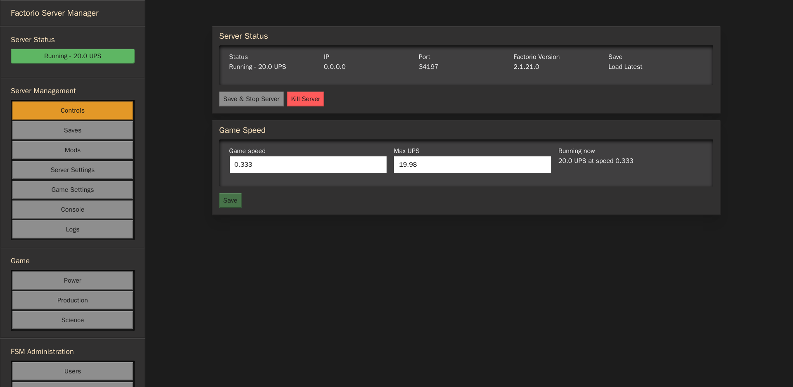
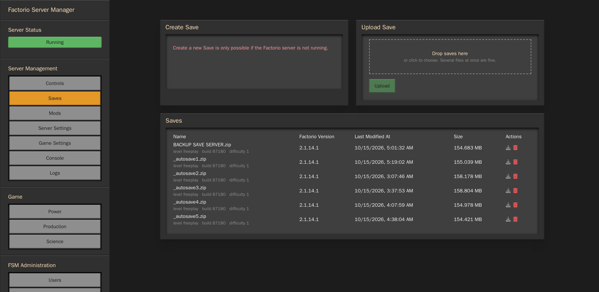
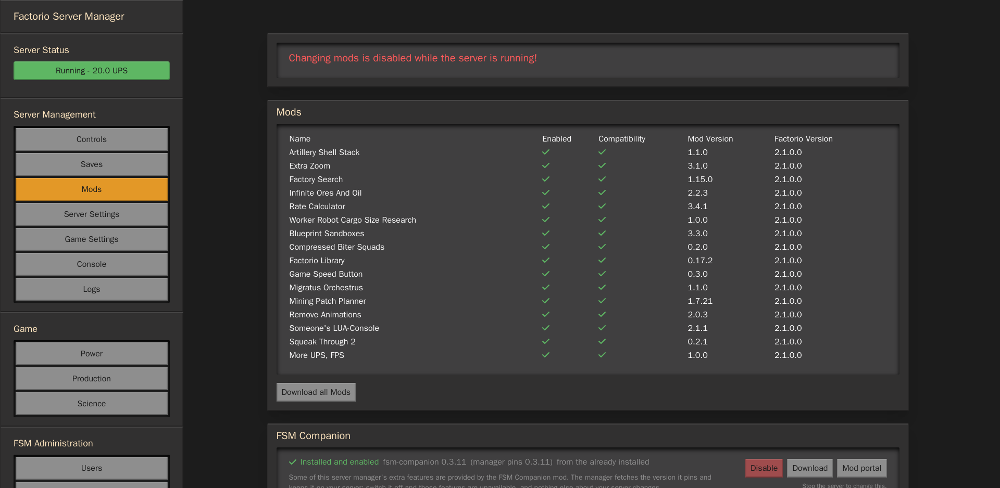
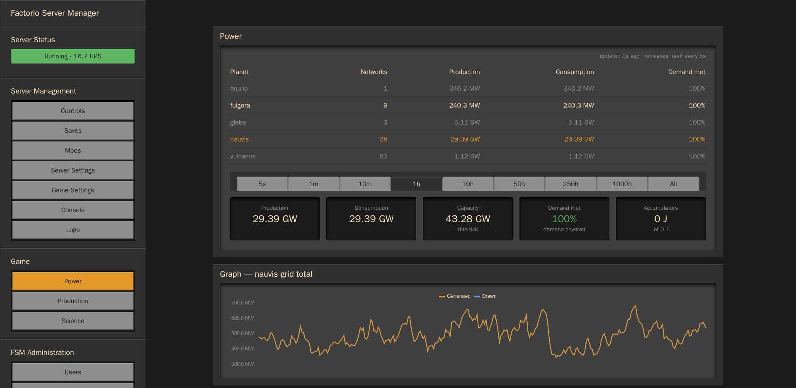
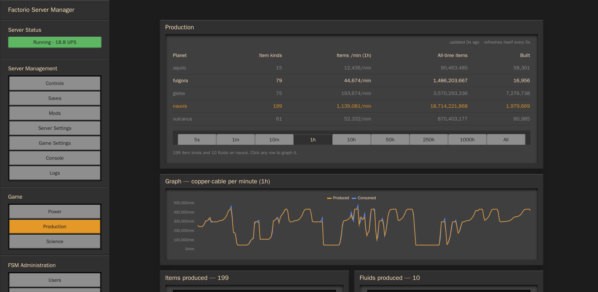
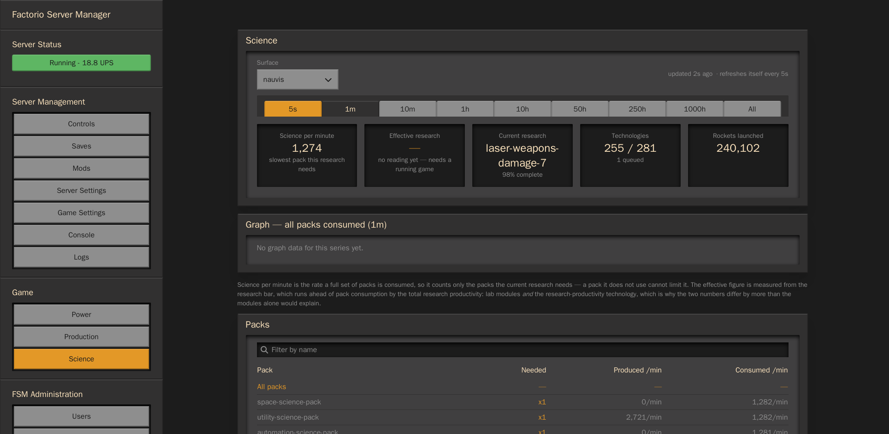

[](https://github.com/NovaProtocol/factorio-server-manager/actions)
[](https://discord.gg/SB647WmSbU)

# Factorio Server Manager

### A tool for managing Factorio servers.
This tool runs on a Factorio server and allows management of the Factorio server, saves, mods and many other features.

This is a fork of [OpenFactorioServerManager/factorio-server-manager](https://github.com/OpenFactorioServerManager/factorio-server-manager)
that adds live dashboards, a companion mod it installs and keeps pinned, mod portal
credentials, a read-only `user` role, and a game-speed control. Upstream's wiki links
at the bottom of this file still apply where the two overlap.

## Features
* Allows control of the Factorio Server, starting and stopping the Factorio binary.
* Allows the management of save files, upload, download and delete saves, with a list that sorts by name, date or size on a click of the column
* Manage installed mods, upload new ones and more
* Manage modpacks, so it is easier to play with different configurations
* Live dashboards for the running game: power per grid, production per planet and
  science per pack, with time windows and graphs refreshed every 5 seconds
* The Server Status pill shows the game's real update rate (`Running - 20.6 UPS`),
  measured by asking the game for its tick every 5 seconds and divided by wall time
* Allow viewing of the server logs and current configuration.
* Authentication for protecting against unauthorized users
* Two roles: `admin` has full management, `user` is read-only (console, mod list, dashboard and server status)
* Sign the manager in to the Factorio mod portal with a password or a personal token, so gated mods can be downloaded
* Available as a Docker container

#### Manage Factorio Server


#### Manage save files


#### Manage mods


#### Dashboards — power, production, science
Each page waits for the companion mod's report before it shows numbers: until the
report arrives the tiles show a loading line instead of a figure, so what the
following screenshots show is live data from the server, not the loading state.





## Companion mod

This fork installs a companion mod, `fsm-companion`, on every startup: it lands in
the server's `mods/` directory as `fsm-companion_<version>.zip` and is added to
`mod-list.json` enabled, so it is present and on by default with nothing to do.
The zip is deliberate: the manager lists mods by walking `.zip` files, so an
unpacked directory would load in the game but never appear on the Mods page.
Disabling it is remembered: an entry that is already in `mod-list.json` keeps
whatever state it has, so turning the companion off in the mod list is not undone
by a restart.

The mod is **not** bundled into the manager binary. The manager installs exactly
one version, named by the `CompanionVersion` const in `src/companion/companion.go`,
and fetches the zip from that version's GitHub release
(`NovaProtocol/factorio-companion-mod`, tag `v<version>`). The repository is
public, so the fetch needs no credentials. If GitHub cannot be reached and a mod
portal credential is stored (see **Mod portal credentials**), it falls back to the
mod portal. Either way the download is checked to be the pinned mod before it is
installed, and other versions are removed so two copies never coexist.

Consequences worth knowing:

- Moving the companion forward means editing `CompanionVersion` and building a new
  manager. That is the point: the const is the compatibility boundary between the
  mod's report format and the manager's parser, so the two can never drift.
- A first start with no reachable source leaves the companion absent rather than
  failing the manager. The Mods page says so, the reason is in the log, and an
  admin can retry with **Fetch now** on that page.
- The mod source lives in the `companion-mod` repository, which is its own repo and
  no longer copied into this one.

The mod's own releases are published by `../companion-mod-output/mod_upload.py`,
which attaches the built zip to a GitHub release and, unless told otherwise, also
uploads it to the mod portal. That directory holds the script, its
`mod_upload.json` state (mod source, output directory, version) and the zips it has
built.

## Dashboards

The server's live statistics live under **Game**, one page per concern, all driven by
the companion mod and refreshed every 5 seconds without a page reload:

| Page | Shows |
|---|---|
| **Power** (`/dashboard-power`) | Production, consumption and capacity in real units, satisfaction, accumulator charge, the biggest consumers and generators, and a graph. |
| **Production** (`/dashboard-production`) | Every item and fluid the surface produces, per surface and per window, plus the surface table. |
| **Science** (`/dashboard-science`) | Science packs produced and consumed per minute, a headline science-per-minute, research progress, and a graph. |

`/dashboard` redirects to Power.

Every page takes a **time window** — 5 seconds through 1000 hours, plus all time —
picked from a row of tabs like the settings pages, labelled in the short form
(`1000h`) so all nine fit.

**Power opens on every planet at once**, totalled per surface with its demand met,
and clicking a planet shows that one in full. That is deliberate: with a dropdown the
first thing you saw was whichever planet happened to be selected, which hid the one
that was starving.

**Picking a series is a click.** Items, fluids, power prototypes and science packs
are lists, and clicking a row graphs it — there is no separate series dropdown to
hunt through. Each list has its own filter box, since 199 item kinds is more than
anyone wants to scroll.

**Long tables scroll inside their panel**, with a themed scrollbar rather than the
browser default: a recessed black track and a bevelled grey thumb that turns orange
on hover, built from the same borders as the rest of the interface. `scrollbar-width`
is deliberately not set — Chrome ignores `::-webkit-scrollbar` when it is, which
would discard the styling in favour of its own thin bar.

**Units.** The game reports power as joules per tick; the pages convert to watts at
60 ticks per second and show kW/MW/GW. All time on Power is a cumulative energy
total rather than a rate, so it is divided by the elapsed ticks and shown as a
lifetime average — that keeps every option in the same units and comparable.

**Satisfaction** is measured per grid, then reported as the tightest one that counts.
Two kinds of grid are excluded, because including either makes the number lie:

- ones carrying under 1% of the load — otherwise a couple of disconnected solar
  panels, reading 0 at night, set the headline;
- ones with **no generators, or nothing drawing** — a fragment with demand and no
  supply always reads 0, but that is a piece of wire connected to nothing rather
  than a brownout, and counting it made whole planets report 0% while the game
  showed them perfectly satisfied.

Only **demand met** is a health figure. The game's production "satisfaction" is
capacity utilisation — production over maximum production — so a low value means an
idle grid, not a short one, and it is shown as capacity rather than as a failure.

**Graphs** are the 300 samples behind the game's own statistics graphs, drawn with
Chart.js so a bar can be hovered for a readout and the axis is labelled in real
units. One series at a time is deliberate: 300 points is a couple of kilobytes, and
the RCON transport the reports travel over caps a frame near 4KB.

Reports are fetched on demand for the page being viewed rather than polled as one
document, and cached in memory — kept for the life of the manager process, shared
between viewers, never written to disk — so a page opens on the numbers it last had
instead of a blank panel and the age line says how old they are. Refreshes happen
behind the request every 5 seconds, so a fetch never queues a browser behind it: the
poll is answered at once with the last report the manager has, and the next poll
picks up the completed one. Only a manager restart starts a page empty, and its
first fetch fills it. The browser caches nothing; the manager is the only cache.

## Game speed

The **Game Speed** panel on the Controls page sets the game's speed, expressed as
either a speed or its equivalent max UPS — they are one equation apart
(`max_ups = speed × 60`, so 0.5 is 30 UPS and 0.333333 is 20). The two fields are
independent while you type: whichever has focus owns what is in it, so clearing one
stays cleared and the other is solved once, when you leave the field. What Save
sends is the value as typed, not as displayed, so typing `1` in Max UPS means speed
1/60 exactly rather than 0.016667, and the pair comes back as 1, not 1.00002.
**Save** applies the choice to the running game at once, and the sidebar pill
confirms with the rate the game is actually achieving — the panel is only usable
while the game is running.

The speed is a runtime setting, so the companion mod remembers the chosen value in
save-scoped storage and re-applies it lazily on the first command after a save load
(the manager asks for something every 5 seconds while any page is open). Save at
0.333333, restart the game, and it comes back at 0.333333 with the UPS pill at 20.

Achievements are never stopped by this: the wiki's rule is that only **script**
commands (`/c`, `/sc`, `/command`, `/silent-command` ...) mark a save as cheated,
and the manager only ever speaks the mod's own plain commands (`/companion-tick`,
`/companion-speed`, `/companion-report`). The speed itself is set inside the mod's
runtime context, the same class of action as the in-game speed-button mods, so no
manager feature routes a script command to the game.

## Science per minute

Science per minute is the rate a **full set** of science packs is consumed, so it
counts only the packs the current research actually needs — a pack the research does
not use cannot be limiting it. The page marks which packs are needed and hides the
number for the rest, and it lists packs that only ever arrive from another planet:
space science is consumed on nauvis but never produced there, so it has no production
entry at all.

A second figure comes from the research bar itself. Labs with productivity modules
turn each pack into more progress than one, so the bar advances faster than pack
consumption suggests — on one late-game Space Age save the measured rate ran about **2.3x** the
pack rate. It is a measurement, not a calculation, so it needs two samples and a game
that is actually ticking. The mod keeps the last good reading with its game-time age:
a dedicated server with `auto_pause` on advances no ticks once nobody is connected,
and rather than blanking the figure in that state the tile remembers the last
measurement and says when it was taken — after a minute of frozen game time the hint
reads "held, measured N game-minutes ago", so a held number is never mistaken for a
fresh one.

## Roles

Every account has one of two roles:

| Role | Can do |
|---|---|
| `admin` | Everything: server control, saves, mods, settings, logs, users, credentials. |
| `user` | Read-only: the console, the mod list, the dashboard and server status. |

The split is enforced by the API, not only by hiding menu entries: a route that
changes something is refused with `403` for a `user`, so a crafted request cannot
reach it either. Users are created from **FSM Administration → Users**; `user` is
the default role there.

Things a `user` deliberately does **not** get: saves, server settings, game
settings, logs, user management and the mod portal credentials page. The console
stays able to send commands, because the game has no per-player command
permission: anyone who may type in the console may type any command in it. That page
passes text through untouched, so a script command typed there (`/c`, `/sc`,
`/silent-command`) permanently disables achievements for the save — the manager
never sends one itself.

## Mod portal credentials

Downloading a gated mod needs a Factorio mod portal account. **FSM Administration
→ Credentials** stores one, in two ways:

- **Password**: the username and password are sent to
  `auth.factorio.com/api-login`; only the returned token is written to disk.
- **Token**: paste the *personal token* from
  [factorio.com/profile](https://factorio.com/profile). It is verified against the
  mod portal before it is stored, and it is the same value the mod download uses,
  so an accepted token works immediately.

A stored credential is kept in `factorio.auth` on the manager's data volume
(`/opt/fsm-data/factorio.auth` in the container), so it survives a restart or a
redeploy; it is a plain JSON file readable by the account the manager runs as, not
encrypted at rest. The page also shows the account data the credential reaches,
which is the mods the account has bookmarked, read from the mod portal with the
stored username and token. **Log Out** deletes the stored file.

## Configuration

Environment comes from the compose file, so there is no `.env` file to forget: put
the values in `compose.yaml` (or export them in the shell before `docker compose up`).
The container refuses to start if any of the required four is missing, and every one
of them is re-applied on each start:

| Variable | Required | Meaning |
|---|---|---|
| `ADMIN_USER` | yes | Username of the admin account. |
| `ADMIN_PASS` | yes | Password of the admin account. |
| `RCON_PASS` | yes | RCON password the manager and the game server share. |
| `COOKIE_ENCRYPTION_KEY` | yes | Base64 key that signs the login session cookie; must decode to 16, 24 or 32 bytes (`openssl rand -base64 32`). |
| `FACTORIO_VERSION` | no | Headless Factorio version to download at first start; `stable` by default, the compose file pins `2.1.21`. |
| `COOKIE_SECURE` | no | The session cookie is marked `Secure` by default; behind plain HTTP (a LAN) set `false`, or the browser discards the cookie and login never sticks. |
| `FSM_AUTOSTART` | no | `true` starts the game server (latest save) when the manager starts. |
| `FSM_RCON_PORT` | no | Fixes the RCON listener port. Unset, the manager picks a free port at random each start. |
| `FSM_WEB_BIND` | no | Interface the web UI is published on, `127.0.0.1` by default. A LAN or tailnet address needs `0.0.0.0`, and `COOKIE_SECURE=false` with it. |
| `FSM_WEB_PORT` | no | Host port for the web UI; `7090` by default. |
| `FSM_GAME_PORT` | no | Host port for the game, `34197` by default, so a second installation can sit beside the first. |
| `FSM_DATA_DIR` | no | Where the manager keeps its own state; `./fsm-data` by default. Point it at an existing installation to upgrade that one in place. |
| `FACTORIO_DIR` | no | Where the game's data lives (`saves/`, `mods/`, `config/`); `./factorio` by default, same idea as `FSM_DATA_DIR`. |

Generate a key with `openssl rand -base64 32` when in doubt.

**Upgrading an existing installation in place.** Set `FSM_DATA_DIR` and
`FACTORIO_DIR` to the directories the old manager used and the new one starts on
that installation's own state: its users, its mod portal credential, its saves, its
mods and its `server-settings.json`. Nothing is copied and nothing is migrated — the
same files are read and written. `conf.json` is the deliberate exception: it is
configuration, rewritten from the environment on every start, so the admin password
follows `ADMIN_PASS` rather than the old file. Reusing the old
`COOKIE_ENCRYPTION_KEY` keeps existing sessions valid.

## Launching

```sh
docker compose build
docker compose up -d
```

The first start downloads the Factorio headless server (a ~60MB fetch) and writes
`conf.json` from the environment; every later start re-applies the same values, so
the configured credentials win over changes made in the interface — the admin
account cannot be locked out or drift. Point a browser at
`http://127.0.0.1:7090` and sign in with `ADMIN_USER`/`ADMIN_PASS`. The game
itself listens on `34197/udp`; the web UI is bound to loopback on the host, so
reaching it from another machine needs a reverse proxy in front. `FSM_AUTOSTART`
loads the latest save into a running game as soon as the manager is up.

## Container

The `compose.yaml` and `Dockerfile` at the repository root build the fork from
source (webpack UI plus the Go binary) and run it with the Factorio runtime
dependencies. The game port is `34197/udp` and the web UI binds to
`127.0.0.1:7090` on the host. State lives in `./fsm-data` and `./factorio`.

`docker/` holds two more compose files — the manager alone, and the same behind
Traefik with Let's Encrypt — both of which build this repository rather than
pulling an image. They are described in [`docker/README.md`](docker/README.md).

## Running it for real

**Back it up.** Backing up is copying two directories: `./fsm-data` (users,
`conf.json`, the mod portal credential, the manager's log) and `./factorio`
(saves, mods, `mod-list.json`, server settings). Stop the game from the Controls
page first if you want a save you can trust; the manager's own state is small
enough to copy while it runs.

**Lost the admin password?** The admin account is configuration, not state: set a
new `ADMIN_PASS` in the environment and restart the container. `conf.json` and the
user database are rewritten from the environment on every start, so this is the
recovery path — the account cannot be locked out. Additional users created in the
interface are unaffected.

**Where the secrets are.** `fsm-data/conf.json` holds the admin password and the
RCON password in clear, and `fsm-data/factorio.auth` holds the mod portal token in
clear — none of them encrypted, all of them `0600` inside the container. Anyone
who can read `fsm-data` can read them, which is the reason to back it up somewhere
private.

**Logs.** The manager and the game share the container's stdout, and every compose
in this repository caps that log at 10 MB × 3 files. The manager also writes its own
log to `fsm-data/factorio-server-manager.log`, which is not rotated — one line per
request, so it grows slowly, but a long-lived deployment should trim it.

**Upgrading.** Pull, `docker compose up -d --build`. The manager removes the
previous companion mod version on start and installs the one it pins, so a mod
update always travels with a manager update: `CompanionVersion` in
`src/companion/companion.go` is the compatibility boundary between the mod's report
format and the manager's parser, deliberately.

**Version compatibility.** The compose file pins `FACTORIO_VERSION` to `2.1.21` and
the companion mod declares `factorio_version: 2.1`. A Factorio 2.2 server would
simply not load the mod, and every dashboard would answer with an error naming the
missing command. Move both together, never one alone.

**Signing in.** The login endpoint is rate limited per address and username: eight
wrong passwords inside five minutes answer `429` with a `Retry-After`, and a
successful login clears the counter. There is no lockout for a correct password.

## [Installation and Usage](https://github.com/OpenFactorioServerManager/factorio-server-manager/wiki/Installation-and-Usage)

## [Development](https://github.com/OpenFactorioServerManager/factorio-server-manager/wiki/Development)

## Contributing
1. Fork it!
2. Checkout the develop branch, only use that as a base: `git checkout develop`
2. Create your feature branch: `git checkout -b my-new-feature`
3. Commit your changes: `git commit -am 'Add some feature'`
4. Add your changes a in human readable way into CHANGELOG.md
4. Push to the branch: `git push origin my-new-feature`
5. Submit a pull request, with `develop` as base :D

## Authors

* **Mitch Roote** - [roote.ca](https://roote.ca)
* **[knoxfighter](https://github.com/knoxfighter)**
* **[Jannaahs](https://github.com/jannaahs)**

## Special Thanks
- **[All Contributions](https://github.com/OpenFactorioServerManager/factorio-server-manager/graphs/contributors)**
- **mickael9** for reverseengineering the factorio-save-file: https://forums.factorio.com/viewtopic.php?f=5&t=8568#

## License

This project is licensed under the MIT License - see the [LICENSE.md](LICENSE.md) file for details
